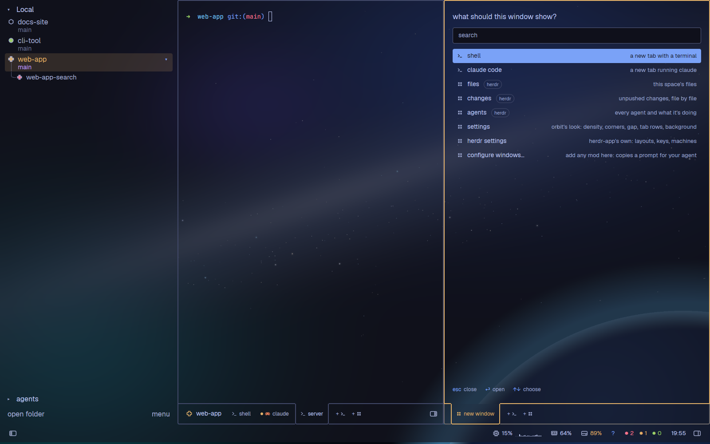

# Orbit

A dark, glassy workspace over a generated space picture. Each space gets a
colour and a symbol of its own, and the pane you're in is outlined in it, with
its tabs as the bottom of that outline. Two panes side by side, each with its
own tabs; a side panel of views; a sidebar of your spaces with their branches;
a status bar with cpu, ram, disk and what your agents are doing.

This file is the brief: enough to build Orbit from an empty folder. The files
next to it are one build of it, for herdr-app 0.1.11.

## What you see

Left to right, then the status bar along the bottom (the system draws the
title bar: `"titlebar": "system"`). Theme `tokyo-night` (Tokyo Night colours:
background `#161622`, surface `#161622`, border `#414868`, foreground
`#c0caf5`, muted `#9aa5ce`, accent `#7aa2f7`). Terminals in JetBrains Mono
14px, padding `[18, 16]`, fully see-through (`terminal_opacity: 0`).

- **Background**: `mods/orbit/backgrounds/space.png` (2560×1600) behind the
  whole window, `fit: "cover"`: a night sky with a pale Milky-Way band across
  it, blue, teal and violet glows, small stars, and the curve of a planet
  rising bottom right.
- **Glass**: the sidebar, the pane, its tab row and the status bar are the
  theme's surface at 62% (`#1616229e`) over a blurred copy of the background
  (`space-blur.png`, Gaussian radius 1.2% of its width), placed exactly where
  the sharp picture is, so the panels look frosted. The terminal area shows the
  sharp picture.
- **Space identity**: each space has one of six colours (`#bb9af7` purple,
  `#7dcfff` cyan, `#9ece6a` green, `#e0af68` yellow, `#ff9e64` orange,
  `#f7768e` red) and one of 8 symbols (hexagon, triangle, square, circle, star,
  plus, cross, diamond, 16px SVGs, outlined and filled).
- **Themes**: `tokyo-night` above, and six others with their own identity
  colours (purple, cyan, green, yellow, orange, red), each known by its
  accent:

  | Theme | Accent | Identity colours |
  |---|---|---|
  | `catppuccin-mocha` | `#89b4fa` | `#cba6f7 #89dceb #a6e3a1 #f9e2af #fab387 #f38ba8` |
  | `everforest` | `#a7c080` | `#d699b6 #83c092 #a7c080 #dbbc7f #e69875 #e67e80` |
  | `gruvbox-dark` | `#83a598` | `#d3869b #8ec07c #b8bb26 #fabd2f #fe8019 #fb4934` |
  | `kanagawa` | `#7e9cd8` | `#957fb8 #7fb4ca #98bb6c #e6c384 #ffa066 #e82424` |
  | `nord` | `#88c0d0` | `#b48ead #8fbcbb #a3be8c #ebcb8b #d08770 #bf616a` |
  | `rose-pine` | `#c4a7e7` | `#c4a7e7 #9ccfd8 #31748f #f6c177 #ebbcba #eb6f92` |

  Any other theme: its ANSI 5, 6, 2, 3, 11, 1.
- **Sidebar**, 400px wide (44–560), glass, corners of radius 16:
  - A header per machine, "Local" first: 27px, 16px semibold, a `▾`/`▸` fold
    (15px, muted). A machine that can't be reached shows "! attention" in red
    and why under it.
  - Each space: its symbol (14px box, centre 14px from the left) outlined in
    muted, in `idle` (`#a9b1d6`) when shown, filled with its agents' state
    colour; its name at 16px (`#a9b1d6`); under it its branch at 14px (muted
    at 62%) with `↑N` green and `↓N` red. A two-line row is 41px, a one-line
    row 27px.
  - The shown space: a band in its identity colour at 16% behind the row
    (radius 4), its name bold in that colour, its branch in `#bb9af7`.
  - Worktrees: one 24px line each (15px name, 12px symbol), hung under their
    repo's row with 1px tree lines (muted at 45%) and an `└─` elbow; the repo's
    row has a 20px `▾`/`▸` fold in accent at its right.
  - At the foot, an 86px block: "▸ agents" (27px row, 16px) and under it
    "open folder" (16px, `#a9b1d6`).
- **Two panes**, sharing the rest of the width (each at least 240px), each in
  an outline 2px wide with corners of radius 16: the one with the keys in the
  shown space's colour, the other in the border colour. Its top is an 18px cap
  with the rounded corners; its sides run down to the tab row.
  - The left pane shows the shown space's own herdr tabs.
  - The right pane, hidden until it holds something, shows the space's
    terminals and views put there; each space has its own.
  - A pending "new window" tab shows the picker in its pane: "what should this
    window show?" (16px semibold), a search field (36px), rows 32px (13px
    icon, 14px name, a pill "herdr" for herdr's own views, the description at
    13px muted on the right; the chosen row in accent), hints "esc close · ⏎
    open · ↑↓ choose" at 12px.
- **The tab row**, 64px, the bottom of the pane's outline:
  - A 6px glass band whose bottom edge is the tab line (2px, outline colour),
    then the row, then the row's edge (2px) with rounded bottom corners, in a
    muted colour: on the pane with the keys, the space colour 30% of the way
    from the border, then 60% of the way to its own grey (`#676579` for
    purple); else the border colour. The outline's sides go on past the tab
    line to that edge (a T).
  - The pane's tabs, 12px in (the space's symbol and name are the
    taskbar's), 26px tall, 12px text, 10px padding: a 6px dot in
    the agent's state colour (an agent with no state: a 6px muted ring), the
    program's 12px icon (a view: the ⠿ mark), the name. Others are `#a9b1d6`,
    lighter on hover.
  - After the tabs, `+ >_` and `+ ⠿` (12px, muted, 26px tall).
  - At the left row's right end, the split toggle: an 18×14 icon of two
    panes, the right one filled while the right pane shows.
  - The shown tab is a folder tab: no tab line above it, its sides (2px, the
    outline colour) curving out of the tab line with radius 6 and down to its
    own bottom edge, which lies on the row's edge; its label in the identity
    colour (foreground when the pane hasn't the keys).
- **Side panel**, hidden at first, 368px (280–900), on the right: views
  (herdr's files and changes to start with), framed like the panes, with a
  tab each in a row like theirs (an 11px ⠿ before each name), then `+ ⠿`.
- **Dialogs and menus**, on the theme's surface at 95% with a 2px border and
  the corner radius: the close dialog (380×150: "close <name>?", "close" in red,
  "keep"), the switcher (560 wide: "projects · N", then a 42px row per space
  with its symbol, name, machine and state), the "make tab N" prompt
  (420×250: a name field and a command field), and menus (240 wide on the
  theme's `popover`, 31px rows with a 14px icon, a key hint on the right).
- **Sidebar foot**: "menu" at the right of "open folder", with an accent dot
  while an update is ready.
- **Status bar**, 40px, glass, corners of radius 16, 13px text, 14px in from each side:
  - Left: the sidebar toggle (an 18px panel icon), a 1px line 18px tall in
    the border colour, the taskbar, then "herdr offline" in red while the core
    can't be reached, "N folded" (muted) for settled tabs, and an accent
    "update ready · restart" pill.
  - The taskbar: cards 26px tall, 8px in, 4px apart, corners of 5, 12.5px
    text; each the space's symbol (14px, as the sidebar's: the filled glyph in
    its agents' state colour while one is blocked, working or done, none
    otherwise; the outline glyph over it, muted, or on the shown space in the
    space's colour, and the card a faint foreground band; look.js
    `spaceSymbol` draws both) and its name (at
    most 150px, cut short); a pinned card then an 11px pin (muted). Cards
    past the bar's room are cut.
  - Right: cpu, ram and disk, each a 14px icon and a bar 34×6 (corners of 3,
    on the muted colour at 25%; blue `#7aa2f7`, yellow `#e0af68` from 70%, red
    `#f7768e` from 90%); the clock (HH:MM).
- **The gap**: the sidebar, the panes, the side panel and the status bar
  stand 14px apart and 14px from the window's edges; under the status bar,
  a 14px block (the `orbit` mod, which draws nothing).
- **The settings change the above** (defaults: comfortable, corners and
  gap on auto, tab rows at the bottom, the generated picture: the look
  above). Densities:

  | | corners | gap | tab row text | status bar | terminal padding | sidebar foot | sidebar scale |
  |---|---|---|---|---|---|---|---|
  | compact | 4 | 6 | 30 | 28 | `[8, 6]` | 67 | 0.9/1.15 |
  | default | 12 | 10 | 38 | 34 | `[14, 12]` | 75 | 1/1.15 |
  | comfortable | 16 | 14 | 46 | 40 | `[18, 16]` | 86 | 1 |

  Corners (auto: the density's, or 0, 4, 8, 12) round the pane outlines,
  their tab rows and, with a gap, the sidebar and status bar. The gap (auto,
  none, 4, 8, 12, 16) sets the panels apart and from the window's edges; the
  block under the status bar is the gap, at least 4px. With no gap the
  panels touch and the sidebar and status bar have square corners. Each pane's cap is corners + 2
  tall and its tab row text + corners + 2. With the tab rows on top, each
  pane's frame is upside down: its row on top, the shown tab open downwards,
  its cap at the bottom. A picture of the person's replaces the background;
  the glass over it is the plain surface at 62%.

## How it behaves

- **Agent states**: blocked `#f7768e`, working `#e0af68`, done `#9ece6a`; idle
  has no colour. They fill the space's symbol in the sidebar and the taskbar and
  colour a tab's dot.
- **Identity**: FNV-1a (32-bit) of a name as UTF-8 bytes; colour =
  hash % 6, symbol = (hash >>> 9) % 8. The name hashed is the space's
  repository's, the same on every machine and for each worktree
  (`mods/orbit/repokey.js`): its `remote.origin.url`'s last part (the URL
  normalised: no scheme, user, port or `.git`, `host:path` as `host/path`),
  else its main checkout's folder (`git rev-parse --git-common-dir`'s
  parent); a space outside a repo hashes its own name. Each space's repo is
  looked up once, on its machine, and kept in shared `"orbit.git"`. match. With another theme than these seven, the colours are its ANSI 5, 6, 2, 3,
  11 and 1.
- **The pane with the keys**: clicking into the side panel moves the coloured
  outline (and the bright lines of its tab row) there; clicking a terminal, a
  tab or a press anywhere in the pane's column brings it back. Hiding the
  panel gives it back to the pane. Switching spaces recolours the outline.
- **Sidebar**: click a space to show it; right-click opens herdr's space menu
  (rename, worktrees, close); drag a row onto another to move the space there.
  Fold toggles fold a machine or a repo's worktrees (remembered). Branches
  refresh when a command or an agent's turn ends, when the repo's git folder
  changes, and once a minute while the window is in front.
- **Tab rows**: click a tab to show it (and give its pane the keys);
  double-click opens a name field where its label is (Enter or a press
  elsewhere keeps the name, Esc cancels); drag a tab onto another to move it
  there (a 2px bar shows where); middle-click closes it; right-click opens a
  menu: Rename, then for a terminal herdr's pane items (Split right, Split
  down, Zoom, right-click routing, Close pane). Tabs too many for the width
  narrow, then scroll sideways; the shown tab and the space's name stay.
- **Closing** a terminal asks first ("close <name>?"); Enter, "close" or the
  same close again confirms, Esc or "keep" keeps it. A view or the picker
  closes at once. Closing a space's last tab closes the space (herdr asks).
- **New**: `+ >_` starts a shell in that pane. `+ ⠿` opens a "new window" tab
  with the picker; a pick opens there: on the left a herdr tab, on the right
  a terminal or view of the right pane. Esc puts back what was shown. Its
  rows: a shell, the installed agents, herdr's files, changes and agents, the
  person's own list, herdr settings, then "configure windows…" (copies a
  prompt for the person's agent and shows a toast with the file's path; the
  picker stays open). The search starts empty each time it shows.
- **The person's own list**: `orbit-windows.json` in herdr-app's home,
  `{ "windows": [ { "title", "about"?, "icon"?, "mod" + "props"? | "command"
  + "args"? } ] }`, read each time the picker shows. A mod opens in the
  picker's pane; a command runs once the picker's tab has gone (a dialog it
  opens stays on top). `"$folder"` in props or args becomes the pane's
  folder. A missing file is an empty list; a broken one shows its error above
  the rows; an entry without a title, or without a mod or command, is skipped
  and named.
- **The right pane**: a terminal there is a herdr tab of its own, shown as a
  terminal block; the left keeps its own tab shown. The split toggle shows the
  right pane (its tabs, or the picker when it has none) or puts it away
  without ending anything. An agent shown from herdr's agents list or an
  alert that lives on the right shows there.
- **Each space's split**: the left and right panes' sizes and the side
  panel's width are the shown space's own. A drag in one space is kept for it
  (shared `"orbit.splits"`: `{ default, spaces: { [space id]: { "left-frame",
  "right-frame": weight, panel: px } } }`); a space switch gives the new
  space's back with `layout.resize` (herdr's clicks, as a drag: the layout
  file isn't written, nothing restarts). A space without one, and a new
  space, gets `default`: the sizes when the first space kept its own. A
  closed space's go.
- **Side panel**: the `orbit.side-panel` command opens it (on what it
  showed, else its first view) and closes it; `+ ⠿` picks a view (files,
  changes, agents), which becomes a tab; right-click a view's tab: Rename,
  Close, Hide the panel; middle-click `+ ⠿` hides the panel. Dragged narrower
  than 140px it closes and opens again at 280px; between 140 and 280 it
  springs back to 280px.
- **Orbit look settings**, a view in the right pane (a tab "Orbit look
  settings"; a 104px label column, then 32px toggles, the chosen one in
  accent; its title at the foot), opened by `ctrl-,` (which shows it again
  when the space has it already) or "Orbit look settings" in the picker (in
  that pane). Each click applies at
  once: the theme (herdr-app's `app.theme`, any window), density, corners,
  gap, tab rows. "background…" opens a file dialog (KDE's `kdialog`, else
  GNOME's `zenity`; from a toolbox or flatpak the host's through
  `flatpak-spawn --host`; with neither, herdr-app's folder picker and the
  folder's pictures as buttons); the picture is copied into
  `backgrounds/` in herdr-app's home (a KDE wallpaper package named after the
  package) and shows at once; "generated" puts the space picture back. Esc
  closes.
- **Sidebar menu**: Search, Settings, Add machine, New space (and New space
  on each connected machine), the shown space's Rename space, New worktree
  and Open worktree (in a git checkout), Remove worktree (in a linked one),
  Close space, Keybinds. ↑/↓, Enter, Esc.
- **Keys** (`keys.json`, section `layout:orbit`, on the pane with the keys):
  `ctrl-1`…`ctrl-9` its tab N (on the left with none: the "make tab N"
  prompt); `ctrl-pagedown`/`alt-]` next, `ctrl-pageup`/`alt-[`/
  `ctrl-shift-tab` previous; `ctrl-shift-t` a new terminal; `ctrl-shift-o`
  and `ctrl-shift-e` a "new window" tab on the right; `ctrl-shift-w` and
  `ctrl-shift-x` close; `alt-h`/`alt-left` and `alt-l`/`alt-right` the keys
  to the left or right pane; `alt-shift-h`/`alt-shift-l` move the shown
  terminal tab across; `ctrl-tab` the space shown before; `ctrl-shift-space`
  the switcher (preselects the space before; ↑/↓ or Tab, 1-9 or Enter, Esc);
  `ctrl-,` the settings.
- **The pane with the keys** follows clicks and herdr's focus; each space
  remembers its own, and a pane that's put away gives the keys to the left.
- **Status bar**: the left button toggles the sidebar. A click on cpu, ram or
  disk opens a popup 300px wide above it, its left edge at the widget's (kept
  in the window): the details, live (load and each core as a bar; used,
  available and swap; the filesystem's sizes). The widget keeps its hover
  band and no tooltip while it's open; a second click, Esc or a click beside
  closes it. Its "open in pane ⇥" opens the same view in the right pane and
  closes the popup. Any popup the bar opens gets `props.pin` (its title),
  `props.pinCommand` (`orbit.new-mod <args as JSON>`, opening the same mod in
  the right pane) and `props.height`. herdr-app takes a popup's `at` in
  window pixels but zooms its width and height, so the bar places it at the
  element's own (unzoomed) position, minus the zoomed height. The cpu popup is
  as tall as its cores need (three columns, 22px a row), cut to the room
  above the bar (then the cores scroll). The popup says when it opens and
  closes (shared `"orbit.popup"`), and the bar decides at the press whether
  its popup was open, so a second click closes it even when the press itself
  dismissed it.
- **Taskbar**: the cards in order: pinned (pin order), the shown space,
  spaces whose agents are done or blocked, then working, each group by the
  last change in its tabs, newest first; an unpinned space with only idle
  agents isn't there. Click shows the space (the card keeps its size).
  Right-click: a one-item menu above the card, Pin or Unpin
  (`"orbit.pinned"`). Drag a card onto another: it takes that card's place
  and is pinned; dropped past the pinned cards it ends them. A 2px accent bar
  shows where it lands.

## Built from

- **Layout** `layouts/orbit.json`, a root column (`theme: "tokyo-night"`,
  `font: "JetBrains Mono"`, `font_size: 14`, the background, `terminal_padding`,
  `terminal_opacity: 0`, `preview: "layouts/orbit.svg"`):
  - `body`, a row:
    - `sidebar`, a column (400px, 44–560, `resizable: false`): `spaces`
      (`orbit-spaces`), `agents` (herdr's `agents`, hidden), `sidebar-footer`
      (86px, `orbit-sidebar-footer`).
    - `work`, a row of three frames. Each frame is a column: `<x>-cap` (18px,
      `orbit-edge` with `props.pane`), `<x>-mid` (a row, `resizable: false`,
      `divider` 2px in the outline colour, holding a zero-wide `orbit-edge`
      block with no props (draws nothing), the content, another zero-wide block: the divider draws the
      outline's sides), `<x>-tabs` (64px, the tab row mod).
      - `left-frame` (min 240): content the stack `left` with the block
        `left-tab` (`{ "tab": "active" }`, pane frame gap 0, radius 0,
        transparent, no border) and `left-pick` (`orbit-add`,
        `props.side: "left"`); tab row `orbit-tabs` with `props.stack: "left"`.
      - `right-frame` (hidden, min 240): content the stack `right` with
        `right-pick` (`orbit-add`, `props.side: "right"`), then what the `orbit`
        mod writes: a `{ "terminal": "<id>" }` block per terminal put on the
        right (`rt-<id>`), a mod block per view (`rm-<hash>`, with `title`);
        tab row `orbit-tabs` with `props.stack: "right"`.
      - `panel` (hidden, 368px, `min` 24 so a drag can close it, max 900):
        content the stack `panel-body` with `panel-pick` (`orbit-add`,
        `props.panel: true`), then a block per view (`panel-v<hash>`, with
        `title`) written by the `orbit` mod; tab row `orbit-tabs` with
        `props.stack: "panel-body"`.
  - `status` (40px, `orbit-status`), `orbit` (14px, the `orbit` mod).
  The root's padding `[0, 14]`, `body`'s and `work`'s gap 14 and `body`'s
  padding `[14, 0]` are the gap; the `orbit` mod writes these sizes from the
  settings.
- **Mods** (all `place: "none"`):
  - `orbit`: keeps the layout file in step. On start, when `layouts/` changes,
    when the theme or the shown space changes and when the keys move, it
    writes into `layouts/orbit.json` the glass colour (`surface` + `9e`) on
    `sidebar`, `left`, `right` and `panel-body`, the `left-mid` / `right-mid`
    / `panel-mid` divider colours (the space's identity on the pane with the
    keys, the border on the others), the right pane's children and the
    panel's views. Every 250 ms it keeps the panes in step (the shown space's
    right pane shown or hidden, its pick selected, the pane with the keys). It
    takes the keys' commands (`nextCommand`) and keeps the recent spaces
    (shared `"orbit.recent"`). It is the only writer of the layout file,
    shared `"orbit.sides"` and `"orbit.settings"`: the other mods ask it for a
    change with `run("orbit.<what> <args as JSON>")` (a mod's command carries
    only its name), and it runs `actions.js` / `layout.js`. It holds
    `backgrounds/`.
  - `orbit-add`: the picker, in a pane (`props.side`), in the panel
    (`props.panel`) or as a dialog. Agents from `knownAgents` (installed
    ones; kept in shared `"orbit.add.known"` per machine). `windows.js` reads
    `orbit-windows.json` and makes the Configure prompt.
  - `defaults/orbit-windows.json`: `{ "windows": [] }`.
  - `orbit-dialogs`, opened with `props.dialog`: `menu` (derived from
    herdr-app's `menu` mod; icons from herdr's shipped `workspace-chrome`),
    `confirm`, `switcher`, `new-tab`, `settings` (in a pane: the orbit mod's
    new-mod; each change asked of the `orbit` mod as
    `run("orbit.settings <JSON>")`; `orbit.settings` alone opens it).
  - `orbit-spaces`: a restyled clone of herdr-app's `spaces` mod.
  - `orbit-tabs`: the panes' rows (`pane.js`, `props.stack` `left` /
    `right`) and the side panel's (`panel.js`, `props.stack: "panel-body"`).
  - `orbit-sidebar-footer`, `orbit-status`, `orbit-edge` (the cap with
    `props.pane`, rounded at its top, or its bottom with the rows on top;
    with no props it draws nothing).
  - `themes/*.json`: the six others, the same keys as `tokyo-night.json`.
  - The settings in shared `"orbit.settings"`: `{ density, rounding, gap,
    tabs, background, views }` (`null`: the density's). The `orbit` mod's
    `layout.js` writes them into the layout (root `background`,
    `terminal_padding`, `padding`; `body` gap and padding; `work` gap; the
    `orbit` block's size; `status`, `sidebar-footer`; each frame's cap and
    tab row sizes and order; the sidebar's radius with a gap) and shares the
    look.
  - Only in `orbit`: `actions.js` (show, new, close, move, split, rename,
    reorder, the panel toggle), `layout.js` (the layout writer, the panel's
    views in shared `"orbit.settings".views`, the look and the tab rows'
    places it shares), `split.js` (each space's split, shared
    `"orbit.splits"`) and `identity.js` (each space's colour and symbol, the
    repo lookup: shared `"orbit.git"`). The orbit mod works these out once
    and shares them: `"orbit.identity"` (`{ [space id]: { color, glyph } }`),
    `"orbit.look"` (the sizes and the background picture), `"orbit.places"`
    (the tab rows' place in the window, for their glass before an event
    gives a row its own).
  - Shared files, copied into the mods that import them (the same file):
    `look.js` (reads the shared look, a space's colour and symbol, the pane
    with the keys; `ask()`), `sides.js`
    (what is where, read from shared `"orbit.sides"`: terminals and views on
    the right, the shown one per space, pending pickers, the pane with the
    keys, names and order), `glass.js` (the blurred backdrop), `rowframe.js` (the tab row's segments
    and folder tab, drag to move, the name field), `tabmenu.js` (a tab's menu
    items), `labels.js` (tab names and icons).
  - `keys.json`: `{ "layout:orbit": { ... } }`, the keys as `orbit.<command>`.
- **herdr API**: `spaces`, `panes`, `agents`, `machines`, `updates`,
  `layout`, `focused`, `theme`, `settings`, `shared`, `setShared`, `exec`,
  `hc`, `readTextFile`, `writeTextFile`, `watchFolder`, `appHome`, `home`,
  `pickFolder`, `notify`, `openOverlay`, `closeOverlay`, `run`, `window`, `nextCommand`,
  `knownAgents`, `terminals`, `keys`. Commands: `space.select`, `space.move`,
  `space.new`, `space.rename`, `space.close`, `tab.new`, `tab.select`,
  `tab.move`, `tab.rename`, `tab.close`, `pane.focus`, `pane.split`,
  `pane.zoom`, `pane.close`, `terminal.right_click`, `terminal.park`,
  `layout.toggle`, `layout.show`, `layout.hide`, `layout.select`,
  `layout.resize`, `agent.focus`, `mod.open`, `app.help`, `app.settings`,
  `app.theme`, `app.update`. Shipped mods: `agents`, `files`, `changes`, `picker`,
  `machine-add`, `worktree`, `menu` (the space menu: `tab: "space"`).
- **Programs**: `git status --porcelain=v2 --branch` and `git rev-parse` in
  each space's folder (on its machine), `hc machine ls --json`,
  `df -B1 --output=used,avail,size,target <home>`; files read: `/proc/stat`,
  `/proc/loadavg`, `/proc/meminfo`, `layouts/orbit.json`,
  `orbit-windows.json` (the picker's list: its entries run what they name).
  The settings' "background…", only when clicked: `kdialog` or `zenity`
  (maybe through `flatpak-spawn --host`), `mkdir`, `ls` (herdr's folder
  picker's folder), `cp` into `backgrounds/`; it writes
  `data/orbit-settings/picked`.
- **Art**: `scripts/space.py` renders the background (procedural, seeded),
  `scripts/blur.py` its blurred copy, `scripts/glyphs.py` the 8 symbols in
  `mods/orbit-tabs/glyphs/`. The status bar's icons, the fillets and the ⠿
  mark are small SVGs in their mods. `layouts/orbit.svg` is the settings
  preview.

## Watch out

- **Copy `themes/` too.** The layout names the theme `tokyo-night`; without
  `themes/tokyo-night.json` herdr-app doesn't apply the layout at all ("theme
  "tokyo-night" is not one of graphite, ink, moss, paper").
- **A layout's own theme changing** (the themes were `orbit`, `orbit-*`)
  makes herdr-app drop that layout's theme pick, and its saved clicks too
  unless `layouts/.state/<layout>.json` names the new theme already.
  `install.sh` renames them there first and picks the theme again after; the
  `orbit` mod picks it again when the saved clicks still name an old one.
- The `orbit` mod rewrites `layouts/orbit.json` (glass and outline colours):
  edit those there and they come back. It must be in the layout for the
  outline to follow the space.
- Paths across mods: the layout and `look.js` use
  `mods/orbit/backgrounds/`; `look.js` uses `mods/orbit-tabs/glyphs/` and
  `labels.js` `mods/orbit-tabs/widget.svg`. Renaming a mod on a name clash
  means changing those paths in every copy.
- herdr-app clips a pane's content inside its frame and has one focus colour
  per layout, so the outline isn't a pane frame: it's the cap block, the
  middle row's divider around zero-wide blocks, and the tab row. The tab
  block's own pane frame stays invisible.
- herdr has no backdrop blur: each glass block draws the blurred picture as
  its bottom layer, placed with the root's cover maths from the window size
  (`viewport_size`) and its own place, divided by the zoom (herdr scales
  lengths a mod writes, but reports sizes unzoomed). gpui clips to rectangles,
  so rounded glass corners are 1px rows of the picture.
- `focused()` says nothing when a press lands in a mod block (the panel's
  files), so the tab rows watch every press (`on_mouse_down_out`) and take
  the ones in their own column.
- herdr's `files` and `changes` draw their own card inside the panel.
- Linux only for cpu, ram and disk (`/proc`, `df`); elsewhere they're hidden.
- The generated picture's size (2560×1600) and its blurred copy are written
  in `look.js` (`GENERATED`). A picture of the person's has no blurred copy:
  the glass over it is the plain fill (`backdrop()` falls back, with the
  same square and round corners).
- The layout's root says `"theme": "tokyo-night"`, but herdr-app's `app.theme`
  wins: the settings' theme buttons and herdr's own settings both work, and
  the space colours follow the theme's accent. A theme opened while a dialog
  is open takes the keys: the settings view takes them back.
- The background's file dialog runs on the person's desktop (from a
  toolbox, the host's through `flatpak-spawn --host`), apart from herdr-app
  (its `exec` stops a command after 30 s): the dialog writes its answer to a
  file, which the settings wait for (`watchFolder`, up to 15 minutes).
  herdr-app has no file picker for mods (only `pickFolder`), hence the
  fallback. Say so in the person's terms before they click it.
- A layout's background picture must be inside herdr-app's home: the chosen
  picture is copied into `backgrounds/`, never referenced where it is.
- **Merge `keys.json`**: add its `layout:orbit` section to the person's
  `keys.json`, asking before replacing a key they already use there.
- A right-pane terminal is a herdr tab of its own: herdr shows it on the left
  for a moment when it starts, then the left's tab is shown again. herdr
  rewrites the layout file when a terminal block's terminal ends (it takes the
  block out); the `orbit` mod's state drops it too.
- A `layout.select` sent before the window has loaded a new child fails ("no
  stack right with a child …"): the shown pick is written into the stack's
  `active` with its children, and selected only once the window has it.
- herdr can't see the keys in a mod block (the picker, a view), so while one
  shows in the pane with the keys, a change of herdr's focus is ignored; the
  rows watch presses instead.
- Enter in the picker reaches both its search field and its list: one pick
  per press.
- The menus' icons come from herdr's shipped `workspace-chrome` mod; another
  herdr version may move them.
- **`orbit-windows.json` is the person's own**: copy `defaults/orbit-windows.json`
  into herdr-app's home only when there's none, and never replace it (on an
  update too). Its entries run what they name (a mod, a herdr-app command):
  tell the person, and add entries only when they ask.
- **Updating**: copies don't update themselves, and the add flow never
  overwrites (it would make `orbit-2`). To update, remove `layouts/orbit.json`,
  `layouts/orbit.svg`, `mods/orbit`, every `mods/orbit-*` (an older copy may
  have more of them: `orbit-panel-tabs`, `orbit-nothing`: all go), the
  old `themes/orbit*.json` and the files in `themes/`, then copy the new ones in, and replace the
  `layout:orbit` section of `keys.json` with the new one; leave the person's
  other files and keys alone, the settings in `shared.json` and the
  pictures in `backgrounds/`. This build is version 3 (`VERSION` in
  `mods/orbit/main.js`, shared `"orbit.version"`).

## Done when

- `herdr-app check` passes for each of the 8 mods, and after
  `layout.switch {"name": "orbit"}` `herdr-app status` lists no errors.
- The background shows behind a see-through terminal, and the sidebar, tab
  row and status bar show the same picture blurred, lined up with it.
- The pane's outline and the shown space's sidebar band are the space's
  identity colour; another space shows another colour; a worktree space and
  its repo share one.
- The tab row's line is open under the shown tab, whose sides curve out of
  it; the row's edge below is muted, with rounded corners.
- An agent reporting working, blocked or done fills its space's symbol and
  its tab's dot yellow, red or green, and its taskbar card appears.
- `orbit.side-panel` opens the side panel with files and changes;
  clicking in it moves the coloured outline there, clicking the terminal moves
  it back.
- cpu, ram and disk update every second (disk every 30 s) and turn yellow and
  red at 70% and 90%.
- The split toggle opens the right pane on the picker; picking "shell" starts
  a terminal there, outlined in the space's colour; the toggle puts it away
  and brings it back with the terminal still running.
- Middle-clicking a terminal tab asks "close <name>?"; Enter closes only that
  terminal.
- Dragging a left tab onto another reorders herdr's tabs; double-click or
  Rename in its menu renames it.
- `ctrl-2` shows the pane's second tab; `ctrl-9` with no ninth tab opens the
  "make tab 9" prompt; `ctrl-shift-space` opens the switcher; `ctrl-tab` goes
  back to the space before.
- The panel's `+ ⠿` adds "agents" as a third view tab; middle-clicking a view's
  tab removes it.
- An entry added to `orbit-windows.json` shows in the picker the next time it
  opens, and opens in that pane; "configure windows…" copies the prompt and
  shows the toast.
- `ctrl-,` opens Orbit look settings in the right pane. "top" puts every tab row on top, the shown
  tab open downwards; gap "none" joins the sidebar, panes, panel and status
  bar with square corners, their glass still lined up with the picture; "compact" makes the rows and bar smaller; each applies at once
  and stays after a restart.
- Each theme button switches the theme, and the space colours follow it
  (Nord: a yellow space is `#ebcb8b`); Esc still closes the dialog after.
- A picture chosen with "background…" (or copied into `backgrounds/` and
  set as `"background"`) shows behind everything, the glass over it plain;
  "generated" brings the space back.
